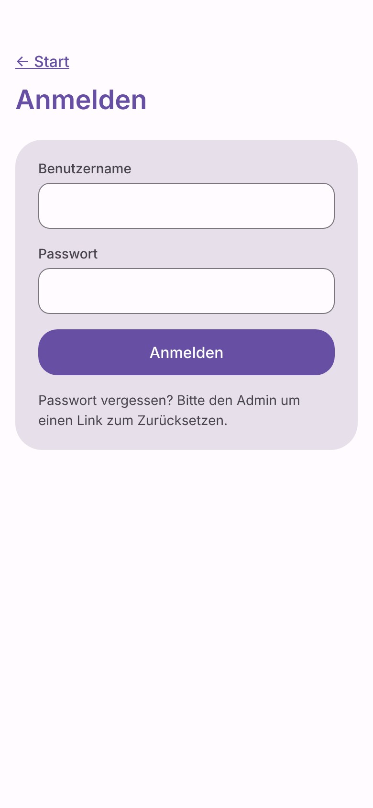
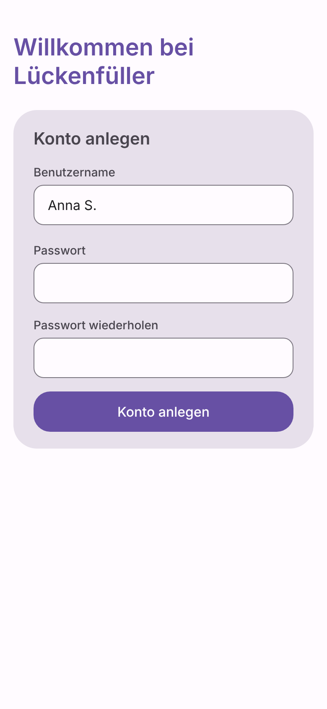
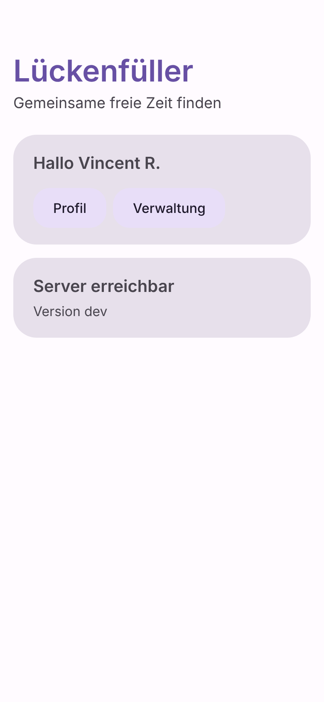
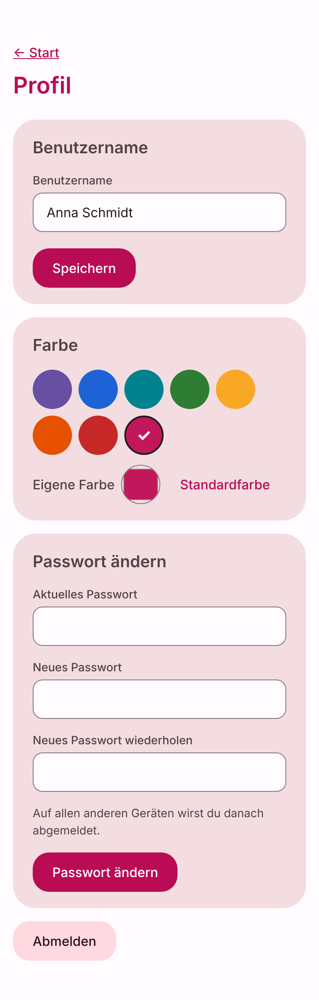
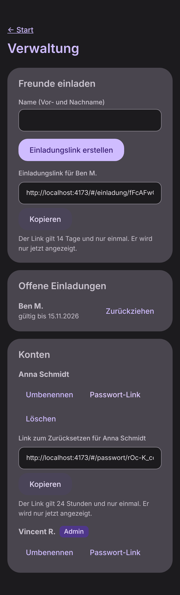
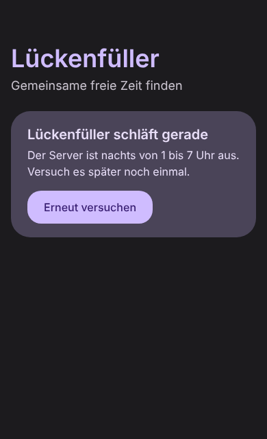

# Lückenfüller

A mobile-first web app for a group of friends. Everyone links their calendars (Google, Apple, Outlook, ...); the
app finds time slots where everyone is free, lets everyone vote on them and sends the chosen date to everyone.

The product is called **Lückenfüller**; the repository is called "Gapfinder". The user interface is **German
only**; everything else (code, docs, commits) is English. All decisions and the phases are in
[`docs/PLAN.md`](docs/PLAN.md).

## Status

**Phase 1c: foundation done.** The app is deployed automatically, the server runs on the home PC with automatic
updates, and there are accounts: friends join through a personal invite link from the admin, log in with username
and password, and change their name, password and colour in their profile. The admin manages invites and accounts
in "Verwaltung" and creates links for forgotten passwords. **Phase 2: calendars.** Everyone links calendars through
their subscription link (the server tries the link at once, stores it encrypted and never shows it again), sets
which count as busy and which is the default, and sees a preview of their own next 4 weeks. Calendar contents
are never stored. Gap search and voting follow in later phases.
The first admin account is created in the VM ([`docs/server-setup.md`](docs/server-setup.md), step 8). The database
is backed up every night, encrypted, to a OneDrive folder on the home PC (step 9 and "Restoring a backup").

| Login                                    | Invite link                                | Start, logged in                                     |
| ---------------------------------------- | ------------------------------------------ | ---------------------------------------------------- |
|  |  |  |

| Profile (own colour)                         | Admin area (dark mode)                      | Server off                                                     |
| -------------------------------------------- | ------------------------------------------- | -------------------------------------------------------------- |
|  |    |  |

## Repository layout

| Folder    | What it is                                                                                   |
| --------- | -------------------------------------------------------------------------------------------- |
| `shared/` | The API contract: types, error codes and rules (usernames, durations) used by both sides.     |
| `server/` | API server: Node.js, TypeScript, Fastify, SQLite (`node:sqlite`). Runs in Docker.            |
| `web/`    | Frontend: Vite, Svelte 5, TypeScript, Material 3 look. Built as a static site.               |
| `deploy/` | Files for the server VM: setup script, hourly update with rollback, nightly backup, firewall, systemd units. |
| `docs/`   | Project plan and decisions, server setup guide.                                              |

It is an npm workspaces monorepo; `shared` is compiled first because the other two import it.

## Develop

Requires Node.js 22.13 or newer (CI and Docker use 24; `.nvmrc` says 24).

```sh
npm install
npm run dev -w server   # API on http://localhost:8080 (restarts on changes)
npm run dev -w web      # frontend on http://localhost:5173
```

The frontend finds the API through `VITE_API_URL` (default `http://localhost:8080`). The server allows calls from
`http://localhost:5173` by default; see `.env.example` for all server settings.

Accounts only come from invite links. For a first local admin account, build the server and create an admin link
(it points to `APP_URL`, default `http://localhost:5173/`):

```sh
npm run build -w server
cd server && node dist/cli.js admin-link "Vorname Nachname"   # uses ./data like the dev server
```

`node dist/cli.js password-link "<username>"` makes a password reset link the same way.

## Test and build

```sh
npm run check   # type checks (including Svelte) in all packages
npm test        # Vitest in all packages
npm run build   # shared, then server (dist/) and web (web/dist/)
```

`npm test` also runs the tests of the VM update and backup scripts (`npm run test:vm`, needs bash and
[age](https://age-encryption.org/)). CI runs exactly these on
every push and pull request, plus a build of the server's Docker image and checks of the VM files (shellcheck,
systemd units, compose file). The VM firewall's test needs root and is run by CI only:
`sudo bash deploy/vm/test/firewall.test.sh` (needs `nft` and `ip`).

## Run the server with Docker Compose

This is for trying the server on any Docker machine. The real server runs in a VM on the owner's PC; its setup
is in [`docs/server-setup.md`](docs/server-setup.md).

```sh
cp .env.example .env    # then set CORS_ORIGIN to the address of the frontend
mkdir -p data && sudo chown 1000:1000 data   # the container runs as user "node" (uid 1000)
docker compose up -d    # pulls ghcr.io/dr-nerdlove/lueckenfueller-api:latest
curl http://127.0.0.1:8080/api/health
```

The database lives in `./data` (mounted as `/data`). The port is bound to `127.0.0.1` only: the server is meant to
be published through Tailscale Funnel, never opened on the router. To build the image from the checkout instead
of pulling it: `docker compose build`.

## Releases and deployment

- **Frontend:** every push to `main` builds the site and publishes it to GitHub Pages
  (`.github/workflows/deploy.yml`). One-time setup in GitHub: Settings, Pages, Source "GitHub Actions"; and a
  repository variable `API_URL` with the public address of the API server.
- **Server:** the same workflow builds the Docker image and pushes it to
  `ghcr.io/dr-nerdlove/lueckenfueller-api` with the tags `latest` and `sha-<short commit>`. The VM checks about once an
  hour, switches to a new image and goes back to the previous one if the new one is not healthy
  ([`deploy/vm/update.sh`](deploy/vm/update.sh)). Setting up the VM, Tailscale Funnel and these updates:
  [`docs/server-setup.md`](docs/server-setup.md).
- Versions follow `vMAJOR.MINOR.PATCH`; changes are listed in [`CHANGELOG.md`](CHANGELOG.md).

## Licence

[GNU Affero General Public License v3.0](LICENSE).
