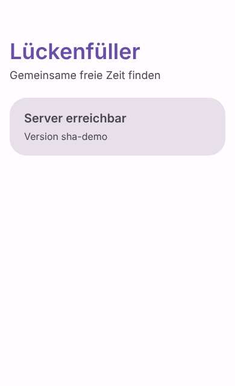

# Lückenfüller

A mobile-first web app for a group of friends. Everyone links their calendars (Google, Apple, Outlook, ...); the
app finds time slots where everyone is free, lets everyone vote on them and sends the chosen date to everyone.

The product is called **Lückenfüller**; the repository is called "Gapfinder". The user interface is **German
only**; everything else (code, docs, commits) is English. All decisions and the phases are in
[`docs/PLAN.md`](docs/PLAN.md).

## Status

**Phase 1a: foundation.** The project skeleton exists and is deployed automatically, but the app can only show
whether the server is reachable. Accounts, calendars, gap search and voting follow in later phases.

| Server reachable (light mode)                          | Server off (dark mode)                                  |
| ------------------------------------------------------ | ------------------------------------------------------- |
|  |  |

## Repository layout

| Folder    | What it is                                                                                   |
| --------- | -------------------------------------------------------------------------------------------- |
| `shared/` | TypeScript types and constants used by both sides (e.g. the `/api/health` answer).           |
| `server/` | API server: Node.js, TypeScript, Fastify, SQLite (`node:sqlite`). Runs in Docker.            |
| `web/`    | Frontend: Vite, Svelte 5, TypeScript, Material 3 look. Built as a static site.               |
| `docs/`   | Project plan and decisions.                                                                  |

It is an npm workspaces monorepo; `shared` is compiled first because the other two import it.

## Develop

Requires Node.js 22.13 or newer (CI and Docker use 24; `.nvmrc` says 24).

```sh
npm install
npm run dev -w server   # API on http://localhost:8080 (restarts on changes)
npm run dev -w web      # frontend on http://localhost:5173
```

The frontend finds the API through `VITE_API_URL` (default `http://localhost:8080`). The server allows calls from
`http://localhost:5173` by default; see `.env.example` for all server settings.

## Test and build

```sh
npm run check   # type checks (including Svelte) in all packages
npm test        # Vitest in all packages
npm run build   # shared, then server (dist/) and web (web/dist/)
```

CI runs exactly these on every push and pull request, plus a build of the server's Docker image.

## Run the server with Docker Compose

```sh
cp .env.example .env    # then set CORS_ORIGIN to the address of the frontend
mkdir -p data && sudo chown 1000:1000 data   # the container runs as user "node" (uid 1000)
docker compose up -d    # pulls ghcr.io/dr-nerdlove/lueckenfueller-api:latest
curl http://127.0.0.1:8080/api/health
```

The database lives in `./data` (mounted as `/data`). The port is bound to `127.0.0.1` only: the server is meant to
be published through Tailscale Funnel, never opened on the router. To build the image from the checkout instead
of pulling it: `docker compose build`.

## Releases and deployment

- **Frontend:** every push to `main` builds the site and publishes it to GitHub Pages
  (`.github/workflows/deploy.yml`). One-time setup in GitHub: Settings, Pages, Source "GitHub Actions"; and a
  repository variable `API_URL` with the public address of the API server.
- **Server:** the same workflow builds the Docker image and pushes it to
  `ghcr.io/dr-nerdlove/lueckenfueller-api` with the tags `latest` and `sha-<short commit>`. The VM updates itself
  from there; the written guide for this follows in phase 1b.
- Versions follow `vMAJOR.MINOR.PATCH`; changes are listed in [`CHANGELOG.md`](CHANGELOG.md).

## Licence

[GNU Affero General Public License v3.0](LICENSE).
