# Lückenfüller

A mobile-first web app for a group of friends. Everyone links their calendars (Google, Apple, Outlook, ...); the
app finds time slots where everyone is free, lets everyone vote on them and sends the chosen date to everyone.

The product is called **Lückenfüller**; the repository is called "Gapfinder". The user interface is **German
only**; everything else (code, docs, commits) is English. All decisions and the phases are in
[`docs/PLAN.md`](docs/PLAN.md).

## Status

**Phases 1 to 7 and 9 ("Growing the circle", 9a to 9e) are done (release v1.9.0).** The app is deployed automatically and the
server runs on the home PC with automatic updates. The load test of the home server (9f) is still to do.

- **Accounts:** friends join through a personal invite link from the admin, log in with username and password, and
  change their password and colour in their profile (the admin sets and changes usernames). The admin manages invites and accounts in "Verwaltung"
  and creates links for forgotten passwords; a new invite comes with a ready "So geht's" text that is sent together
  with the link (e.g. over WhatsApp). Everyone except the admin can delete their own account in the profile.
- **Calendars:** everyone links calendars through their subscription link (the server tries the link at once,
  stores it encrypted and never shows it again), sets which count as busy and which is the default, and sees a
  preview of their own next 4 weeks. Calendar contents are never stored.
- **Gap search:** choose people (with a search field and your own private groups such as "Spieleabend"), a period and a
  duration (or whole days) and see when everyone is free, and the best times when almost everyone is ("13 von 15
  können"; up to a fifth of the people may be missing). People without a readable calendar are named, not silently
  left out.
- **Voting:** pick free times as proposals and share one link; everybody with it, guests too, votes with
  Ja / Vielleicht / Nein and sees the state of the vote. A card names the people whose calendar was not considered,
  and a logged-in person sees under each proposal whether they are free or busy according to their own calendar.
  "Meine Abstimmungen" lists your polls.
- **Fixing the date:** the creator or the admin fixes one proposal after a fresh calendar check (a warning, never
  a block). Everybody with the link sees the date and can download it as `.ics` or add it to Google Calendar or
  Outlook; in the profile, a personal calendar feed puts the fixed dates into any calendar app.
- **Notifications:** switch them on per device (Web Push in the browser) to hear about new polls, votes and fixed
  dates, and choose which kinds you want; poll creators can send a reminder to people who have not voted yet. A
  privacy page explains what is sent and to whom.
- **Android app:** the button "Android-App herunterladen" in the app (Android phones in the browser) downloads the
  newest APK directly; it is also on the release page ([details below](#android-app)). Instant notifications come
  through a content-free Firebase "doorbell", a check every 15 minutes is the backup, and the app updates itself.

Not built yet: connecting Google or Outlook directly, and an offline vote queue (phase 8, optional).
The first admin account is created in the VM ([`docs/server-setup.md`](docs/server-setup.md), step 8). The database
is backed up every night, encrypted, to a OneDrive folder on the home PC (step 9 and "Restoring a backup"); the
admin sees a warning on the start page when a backup is missing or the monthly trial restore is due.

| Login                                    | Invite link                                | Start, logged in                                     |
| ---------------------------------------- | ------------------------------------------ | ---------------------------------------------------- |
| 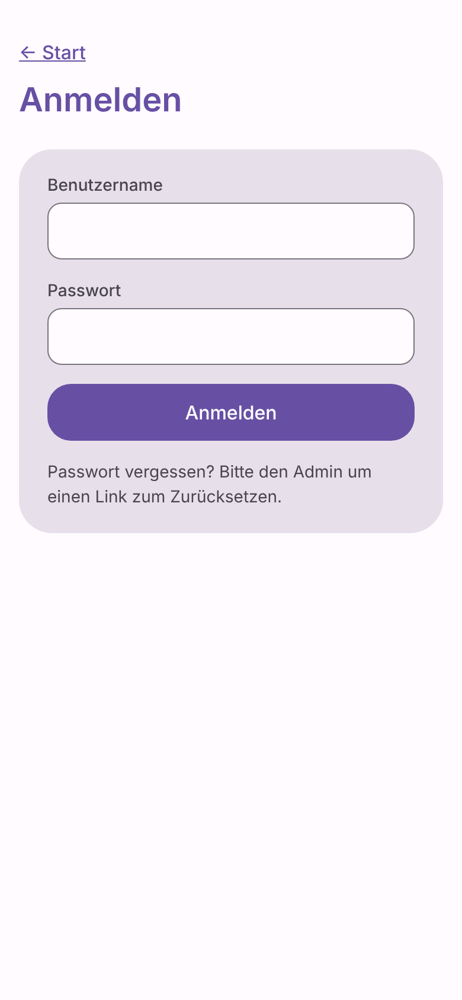 | 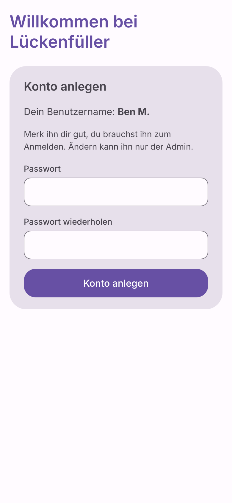 | 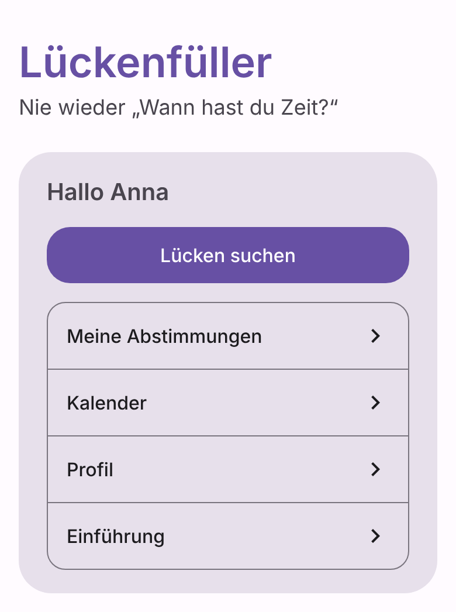 |

| Profile (with "Konto löschen" at the end)    | Admin area: new invite with "So geht's" text (dark mode) | Server off                                                     |
| -------------------------------------------- | ------------------------------------------- | -------------------------------------------------------------- |
| 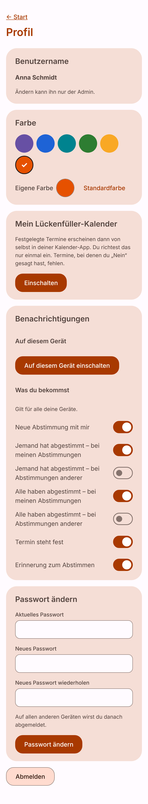 | 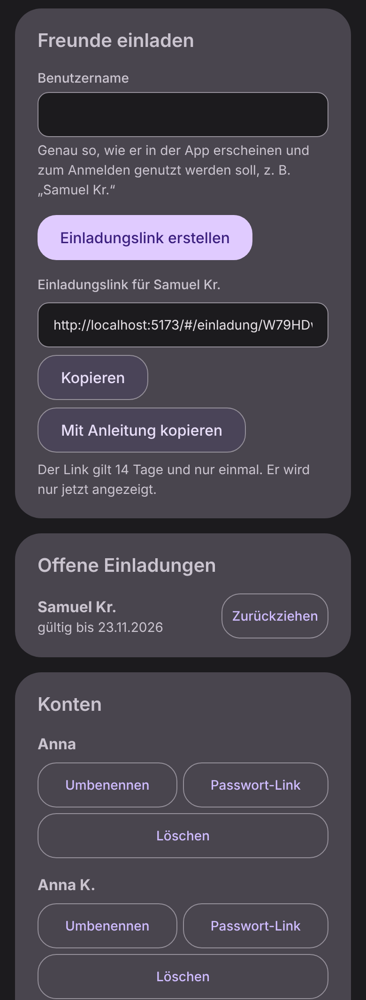   | 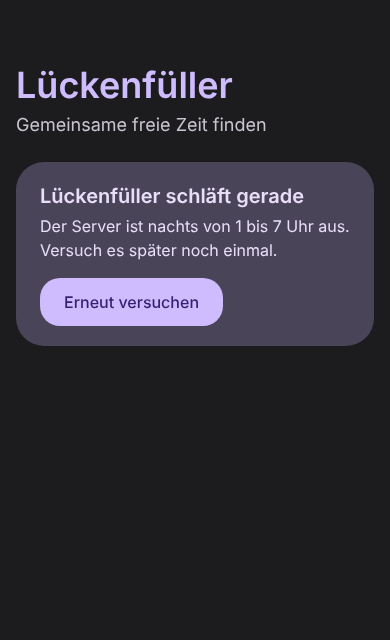 |

| Gap search: own groups and the choice of people  | Result: hours, "Fast alle" for 12 people         | Result: days in a row                                  |
| ------------------------------------------------ | ------------------------------------------------ | ------------------------------------------------------ |
| 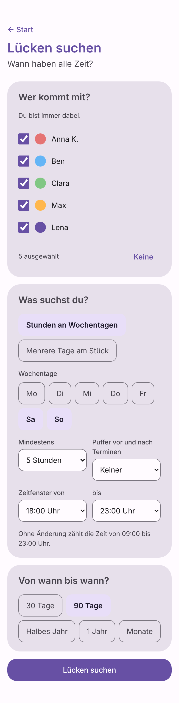 | 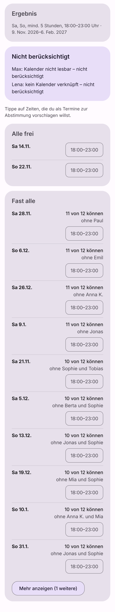 | 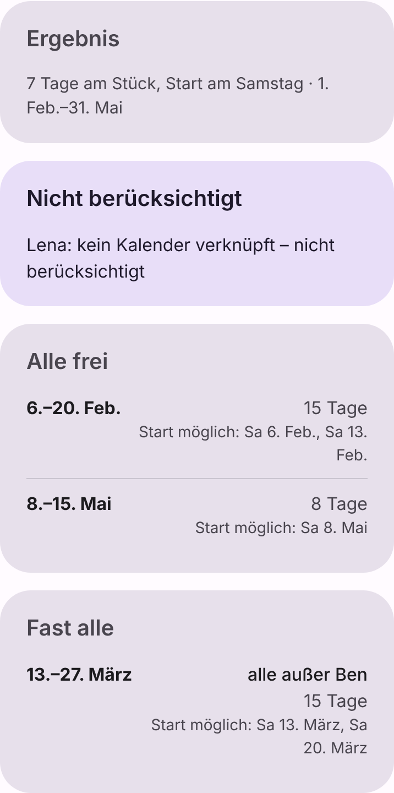 |

| Poll: state and voting                              | Poll: left-out people and own calendar              | Fixing the date: choose, then check                       |
| --------------------------------------------------- | --------------------------------------------------- | --------------------------------------------------------- |
| 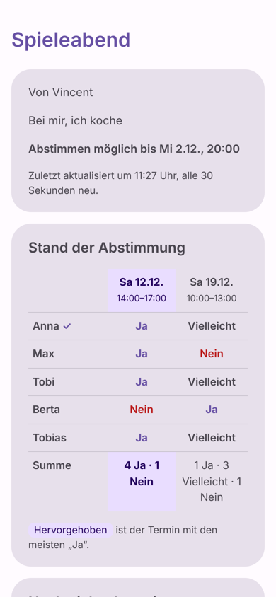 | 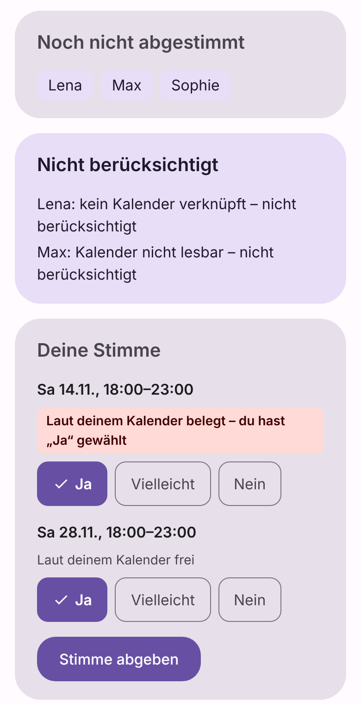 | 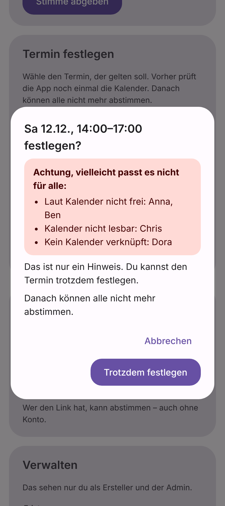 |

| Date fixed (what everybody sees)                          | Notifications (profile card)                                  | Reminder (poll creator)                                    |
| --------------------------------------------------------- | ------------------------------------------------------------- | ---------------------------------------------------------- |
| 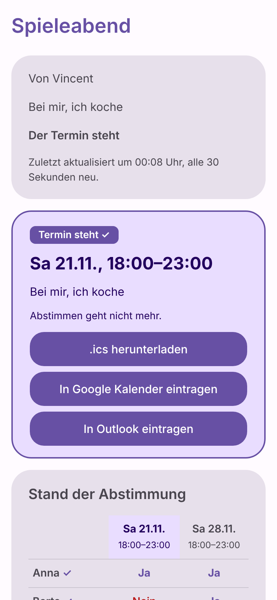 | 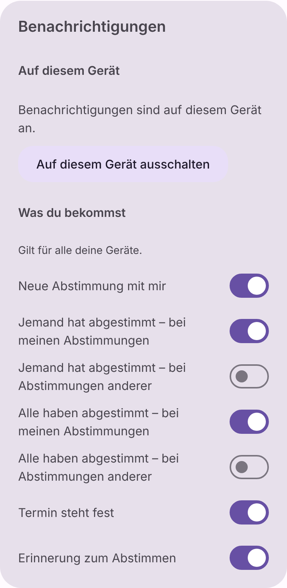 | 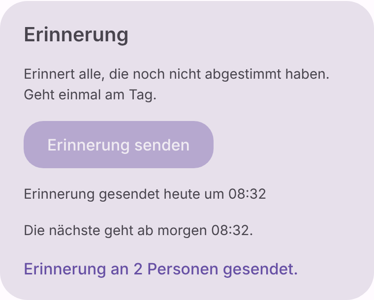 |

| iPhone: add to the home screen first                                |
| ------------------------------------------------------------------- |
| 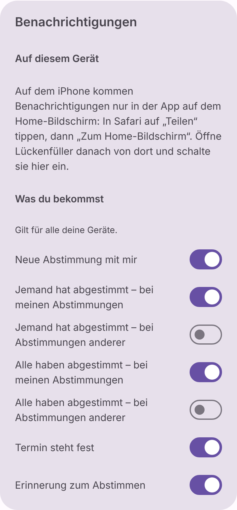 |

## Repository layout

| Folder    | What it is                                                                                   |
| --------- | -------------------------------------------------------------------------------------------- |
| `shared/` | The API contract: types, error codes and rules (usernames, durations) used by both sides.     |
| `server/` | API server: Node.js, TypeScript, Fastify, SQLite (`node:sqlite`). Runs in Docker.            |
| `web/`    | Frontend: Vite, Svelte 5, TypeScript, Material 3 look. Built as a static site.               |
| `deploy/` | Files for the server VM: setup script, hourly update with rollback, nightly backup, firewall, systemd units. |
| `docs/`   | Project plan and decisions, setup guides.                                                    |

It is an npm workspaces monorepo; `shared` is compiled first because the other two import it.

## Develop

Requires Node.js 22.13 or newer (CI and Docker use 24; `.nvmrc` says 24).

```sh
npm install
npm run dev -w server   # API on http://localhost:8080 (restarts on changes)
npm run dev -w web      # frontend on http://localhost:5173
```

The frontend finds the API through `VITE_API_URL` (default `http://localhost:8080`). The server allows calls from
`http://localhost:5173` by default; see `.env.example` for all server settings.

Accounts only come from invite links. For a first local admin account, build the server and create an admin link
(it points to `APP_URL`, default `http://localhost:5173/`):

```sh
npm run build -w server
cd server && node dist/cli.js admin-link "Vorname"   # uses ./data like the dev server
```

`node dist/cli.js password-link "<username>"` makes a password reset link the same way.

## Test and build

```sh
npm run check   # type checks (including Svelte) in all packages
npm test        # Vitest in all packages
npm run build   # shared, then server (dist/) and web (web/dist/)
```

`npm test` also runs the tests of the VM update and backup scripts (`npm run test:vm`, needs bash and
[age](https://age-encryption.org/)). CI runs exactly these on
every push and pull request, plus a build of the server's Docker image and checks of the VM files (shellcheck,
systemd units, compose file). The VM firewall's test needs root and is run by CI only:
`sudo bash deploy/vm/test/firewall.test.sh` (needs `nft` and `ip`).

The pictures in `docs/screenshots` are taken by `bash scripts/docs-screenshots/run.sh --install` on a throw-away server
with made-up people ([`scripts/docs-screenshots/README.md`](scripts/docs-screenshots/README.md)).

Android (JDK 21 and the Android SDK, see [`docs/android-app.md`](docs/android-app.md)): `bash scripts/android-apk.sh`
checks that the committed Capacitor files are current, runs the Kotlin unit tests and the debug build; CI's `android`
job does the same through `.github/actions/android-apk`.

## Android app

An Android app (a Capacitor shell around the live web app, with notifications from a background check) is built from
`android/`. Install, signing key, local build and rules for changes: [`docs/android-app.md`](docs/android-app.md).
CI builds it on every push; each release carries the signed APK (`lueckenfueller-<version>.apk`) and `app-update.json`; the app offers an update itself when a release brings a new app shell. Instant notifications (through a content-free
Firebase "doorbell") need a one-time Firebase setup: [`docs/firebase-setup.md`](docs/firebase-setup.md).

## Run the server with Docker Compose

This is for trying the server on any Docker machine. The real server runs in a VM on the owner's PC; its setup
is in [`docs/server-setup.md`](docs/server-setup.md).

```sh
cp .env.example .env    # then set CORS_ORIGIN to the address of the frontend
mkdir -p data && sudo chown 1000:1000 data   # the container runs as user "node" (uid 1000)
docker compose up -d    # pulls ghcr.io/dr-nerdlove/lueckenfueller-api:latest
curl http://127.0.0.1:8080/api/health
```

The database lives in `./data` (mounted as `/data`). The port is bound to `127.0.0.1` only: the server is meant to
be published through Tailscale Funnel, never opened on the router. To build the image from the checkout instead
of pulling it: `docker compose build`.

## Releases and deployment

- **Frontend:** every push to `main` builds the site and publishes it to GitHub Pages
  (`.github/workflows/deploy.yml`). One-time setup in GitHub: Settings, Pages, Source "GitHub Actions"; and a
  repository variable `API_URL` with the public address of the API server.
- **Server:** the same workflow builds the Docker image and pushes it to
  `ghcr.io/dr-nerdlove/lueckenfueller-api` with the tags `latest` and `sha-<short commit>`. The VM checks about once an
  hour, switches to a new image and goes back to the previous one if the new one is not healthy
  ([`deploy/vm/update.sh`](deploy/vm/update.sh)). Setting up the VM, Tailscale Funnel and these updates:
  [`docs/server-setup.md`](docs/server-setup.md).
- **Server watch:** `.github/workflows/health.yml` checks `/api/health` hourly (not at night) and GitHub e-mails the
  owner when the server has not answered for about 10 minutes; from 50 days without a change on `main` it also sends a
  daily reminder, because GitHub would switch the check off after 60 days.
- Versions follow `vMAJOR.MINOR.PATCH`; changes are listed in [`CHANGELOG.md`](CHANGELOG.md).
- **GitHub release:** made automatically (`.github/workflows/release.yml`) after the deploy of a push to `main` finished
  green and that push carries a version in `package.json` that has no release yet: it sets the tag `vX.Y.Z` and creates the release with the summary at the top
  of that version's `CHANGELOG.md` section. To release: one pull request that sets the four `package.json` versions
  (`npm version <x.y.z> --workspaces --include-workspace-root --no-git-tag-version`) and turns `[Unreleased]` into
  `[x.y.z] - date` with a short summary in plain words before its first `###` heading; merging it is the release.

## Licence

[GNU Affero General Public License v3.0](LICENSE).
